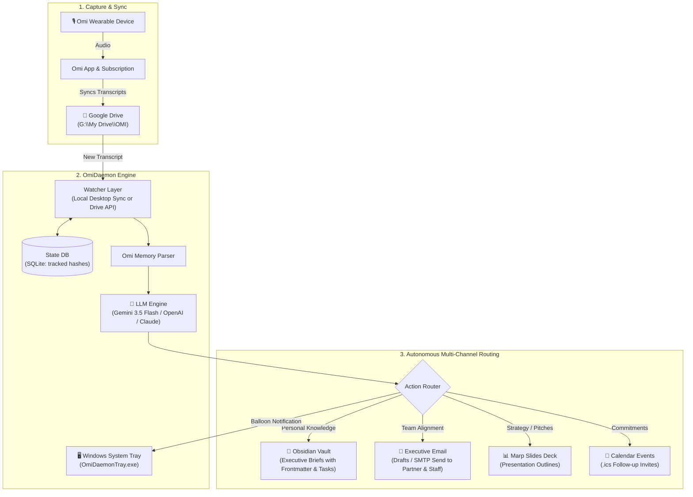

# 🎙️ OmiDaemon

> **Autonomous Executive Intelligence Daemon & Windows System Tray App for Omi Wearable Transcripts**

[](LICENSE)
[](pyproject.toml)
[](windows/)
[](https://notch.live)

---

## 💡 The Why: Elevate Your Omi Wearable

Wearable AI devices like **[Omi (Based Hardware)](https://www.basedhardware.com/)** are incredible hardware for capturing conversations, meetings, and thoughts on the go. 

While the official Omi companion app and subscription reliably sync raw transcript memories to your **Google Drive**, the default in-app processing is often limited, rigid, and disconnected from your personal workflow.

**OmiDaemon** gives you complete ownership over your conversation data:
* **Your Own AI Brain**: Process notes with your own **Google Gemini**, **OpenAI**, or **Anthropic** API key (including Gemini's free tier).
* **Deep Executive Context**: Analyzes conversations through an elite Chief of Staff persona for CEOs and CTOs.
* **Instant Autonomous Routing**:
  * 📓 **Obsidian Knowledge Base**: Automatically writes clean, structured Markdown notes with YAML frontmatter, tags, and checklist tasks into your vault.
  * 📧 **Partner & Staff Briefings**: Drafts or automatically sends executive updates to your partner or team when decisions are made.
  * 📊 **Slide Deck Drafts**: Automatically generates [Marp](https://marp.app/) markdown presentation decks when pitches or strategic reviews are discussed.
  * 📅 **Calendar Follow-ups**: Extracts scheduled commitments and creates standard `.ics` calendar invitation files.
* **Native Windows System Tray App**: Sits silently by your clock with real-time balloon notifications whenever a new memory is processed.
* **100% Idempotent**: SQLite state database tracks file hashes to ensure no conversation is ever reprocessed or duplicated.

---

## 🏗️ Architecture



---

## ⚡ Quick Start

### 1. Prerequisites
- **Windows 10 / 11**
- **Python 3.11+**
- **Google Drive for Desktop** (or Google Drive API credentials)
- An active **Omi (Based Hardware)** device syncing transcripts to Google Drive

### 2. Installation

Clone the repository and install in editable mode:
```powershell
git clone https://github.com/AndriaNjoku/OmiDaemon.git
cd OmiDaemon
python -m pip install -e .
```

### 3. Configuration

Copy `.env.example` to `.env`:
```powershell
copy .env.example .env
```

Open `.env` and configure your settings:
```ini
# LLM Provider & Key (Gemini Flash has a free tier!)
OMIDAEMON_LLM_PROVIDER=gemini
OMIDAEMON_LLM_MODEL=gemini-3.5-flash-lite
OMIDAEMON_LLM_API_KEY=your_gemini_or_openai_api_key

# Google Drive Source Path (Where your OMI transcripts sync)
OMIDAEMON_DRIVE_PATH=G:\My Drive\OMI

# Obsidian Output Vault
OMIDAEMON_OBSIDIAN_VAULT=C:\Users\YourUser\Documents\ObsidianVault
OMIDAEMON_OBSIDIAN_SUBDIR=Executive Briefs

# Email Updates (Optional - set true to email partner/staff)
OMIDAEMON_EMAIL_ENABLED=false
OMIDAEMON_EMAIL_PARTNER=partner@company.com
OMIDAEMON_EMAIL_STAFF=team@company.com
```

---

## 🖥️ Running OmiDaemon

### Output relevance and Google Calendar

New transcripts are screened for lasting personal or professional relevance. Incidental media, fictional dialogue and low-value fragments are tracked without generating outputs; mixed audio retains meaningful user remarks. Email and slide drafts require an explicit request or agreed follow-up rather than being generated for every strategic-sounding conversation.

Calendar proposals must have an agreed commitment, a matching source quote and an exact future timestamp with a timezone. Ambiguous or historical dates are held rather than replaced with a guessed appointment. Local ICS exports use the extracted interval.

Google Calendar sync is opt-in and separate from the Gemini API key. `OMIDAEMON_GOOGLE_CALENDAR_ENABLED=true` enables a local outbox; a separately configured connected-calendar worker consumes it. The outbox alone does not write to Google. See [calendar sync setup and review procedure](docs/calendar-sync.md) for duplicate checks, conflict handling and local scheduling requirements. Email sending remains separately controlled by `OMIDAEMON_EMAIL_ENABLED`.

### Option A: Native Windows System Tray Companion *(Recommended)*
Launch the Windows System Tray application:
```powershell
python -m omidaemon.cli tray
# or double-click windows\OmiDaemonTray.exe
```

**Tray Features:**
* Sits in your Windows Notification Area (System Tray).
* Right-click menu:
  * **Scan Google Drive Now** — Instant check for new recordings.
  * **Open Obsidian Notes** — One-click access to your generated notes.
  * **Open Google Drive Folder** — Direct link to your synced recordings.
  * **View Activity Log** — Quick diagnostic view.
  * **Auto-Start with Windows** — Toggle automatic background start on login.
* Displays native Windows balloon notifications whenever a transcript is digested!

### Option B: Silent Background Daemon
```powershell
# Start silent background process (windowless via pythonw)
python -m omidaemon.cli start-bg

# Check background status
python -m omidaemon.cli status-bg

# Stop background process
python -m omidaemon.cli stop-bg
```

### Option C: Manual Single File Processing (CLI)
Test or process any specific recording file immediately:
```powershell
python -m omidaemon.cli process "G:\My Drive\OMI\OMI_20261021_195643.txt"
```

---

## 📓 Sample Obsidian Output

Here is what an automated note generated by OmiDaemon looks like inside your Obsidian vault:

```markdown
---
title: "Investigation of Lip-Sync Hardener vs Audio Usage"
date: 2026-10-21
category: engineering_sync
source_file: "OMI_20261021_195643.txt"
tags:
  - meeting
  - wearable-notes
  - executive
  - omi
  - topic/lip-sync
  - project/audio-pipeline
---

# Investigation of Lip-Sync Hardener vs Audio Usage

*Recorded via Wearable Audio on 2026-10-21* | Source: `OMI_20261021_195643.txt`

## 📋 Executive Summary
The executive raised a question regarding the necessity of a lip-sync hardener in the pipeline, questioning whether raw audio could be utilized directly instead. An assignment was given to investigate how the hardener functions and evaluate audio-only alternatives.

## 🎯 Key Decisions
- **Decision:** Initiate an investigation into the necessity and functioning of the lip-sync hardener versus using direct audio.

## ✅ Action Items
- [ ] [MEDIUM] **Investigate how the lip-sync hardener works and evaluate if audio can be used instead** (@Engineering Team)
  - *Context:* Executive questioned technical dependency and requested alternative analysis.

## 🧭 Routing & Context
- **Obsidian Vault:** Saved to `Executive Briefs`
- **Email Dispatch:** Not triggered (internal engineering inquiry)
```

---

## 🧪 Testing

OmiDaemon includes a full automated test suite:
```powershell
$env:PYTHONPATH="src"
python -m unittest discover tests -v
```

---

## 🛡️ Notch Standard 1.0 Supervised Release

This project is developed and released under **Notch Standard 1.0** and supervised in-flight by **Nudge by Notch**:
* **Cryptographic Release State**: Validated on local Earned ledger (`events.jsonl`).
* **Deterministic Acceptance**: Automated test suites executed with clean workspace hashes.
* **Privacy & Security**: Zero hardcoded secrets; credentials remain strictly in local `.env` files.

---

## 📄 License

Distributed under the **MIT License**. See [`LICENSE`](LICENSE) for details.
